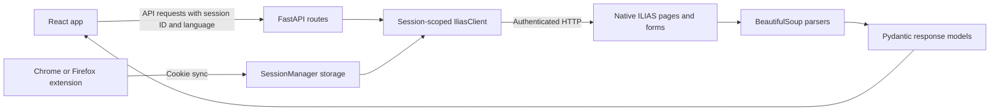

# Architecture

This document describes the current implementation. Exact feature coverage is
in the [support inventory](ILIAS_SUPPORT_MATRIX.md); future work belongs in
[TODO](../TODO.md). Development and repair procedures are in
[DEVELOPMENT.md](DEVELOPMENT.md).

## Request and data flow

The backend is an HTTP/scraping bridge, not a replacement ILIAS database. Routes
obtain a session-scoped client, fetch native pages, parse supported structures
and return typed data. Downloads stream through an authenticated proxy. Native
write forms supply their current URLs, commands, tokens and defaults; write
services verify the resulting state rather than treating HTTP 200 as success.

The frontend uses React 19, TypeScript, Vite, Tailwind CSS and Lucide icons.
The backend uses FastAPI/Uvicorn, async `httpx`, BeautifulSoup/lxml and Pydantic.
Playwright supports interactive login and browser regression tests; routine
course browsing and native writes use HTTP rather than browser automation.
Both browser extensions use Manifest V3, with browser-specific session handoff.

## Sessions and login

- The app keeps `betterilias_session_id` in localStorage and normally sends it
  in `X-Session-Id`. Cookies and additional request mechanisms are supported by
  [API dependencies](../backend/api/deps.py).
- [SessionManager](../backend/auth/session.py) stores tenant cookies/metadata
  under `.sessions/<session_id>.json` and constructs authenticated HTTP clients.
- Extension sync and phone sharing use tenant sessions. A shared phone/desktop
  session expires or logs out together.
- The interactive `login.py` helper writes the legacy default
  `session_cookies.json`. Running it does not refresh an existing tenant ID.
  The browser-login API can target the request's resolved tenant.
- With no explicit session ID, dependency resolution uses the default session
  when available, then the most recently saved tenant session as a local
  development fallback. This fallback does not change explicit tenant routing.

Session-loss detection and scraper safety rules are maintained in
[AGENTS.md](../AGENTS.md). In particular, an access-denied notice inside a
logged-in student's archived course must not be mistaken for global logout.

## Content models and rendering

[Material parsing](../backend/scrapers/materials.py) produces material items,
sections, session drawers, rich-content blocks and nested column blocks.
Known headings, accordions, resource groups and list/tile hints preserve the
lecturer's page structure. PDF and supported embedded Opencast content have
special handling. Known mathematical markup is retained for MathJax rendering.
Sidebars/news controls are excluded from material extraction.

Repository objects and page elements have different storage/lifecycle models.
A file or exercise has a repository identity; a page element can merely display
or refer to it. The [management plan](UNIFIED_MANAGEMENT_PLAN.md) maps that
distinction to one authoring UI. The support inventory records the actual
handling of all catalogued types and the saved page-editor menu.

The semester scraper handles Uni Bern's semester view and available course
actions. Repository browsing handles category/course/group containers separately
from course-page rendering. Semester defaults/ranges are computed by
[semester utilities](../frontend/src/lib/semesterUtils.ts), not fixed to the
historical semesters used in fixtures.

## Navigation, cache and notifications

- [App](../frontend/src/App.tsx) coordinates course/container/exercise navigation
  and history state. URLs preserve selected courses, folders and exercise tabs.
- Cached data can render while a background request revalidates it. This avoids
  unnecessary blank screens; it is not a zero-latency guarantee.
- Request sequence IDs, active-container checks and keyed CourseView instances
  prevent late responses from displaying one course's materials in another.
- [Cache helpers](../frontend/src/lib/cache.ts) store material/semester/podcast
  and exercise data, timestamps and personal display preferences in localStorage.
  ILIAS Saver can skip background revalidation within a user-selected TTL;
  manual refresh and management updates fetch fresh data.
- Empty-scrape guards preserve existing populated caches. Verified deletion
  explicitly invalidates affected entries and refills an emptied parent so
  those guards do not resurrect removed items.
- Course logs use paginated native news fetching and accumulated local history.
  Background content comparisons drive course-update notifications. TA grading
  uses a separate persistent feedback bar.
- [Navigation guards](../frontend/src/lib/navigationGuard.ts) track unsaved
  editors/order drafts and pending mutations, including upload queues. These
  guards complement backend verification; they are not server transactions.

## Authoring and write verification

The authoring and management services are separate mixins of
[IliasClient](../backend/services/ilias_client.py). They read fresh permission
indicators and native forms, keeping action URLs/tokens on the server.

File uploads have two native steps: temporary upload, then metadata/license
submission using the returned resource ID. Up to three queued files run
concurrently with independent outcomes. The UI uses circular activity indicators
and confirms completion only after backend verification.

Management deletion reviews direct selected files/folders, inspects supported
nested containers and follows the native repository confirmation form. Sorting
uses native position controls and a revision check. Neither path invents
COPage commands or treats removing a display block as deleting its resources.
The management plan contains the detailed safeguards and native evidence.

Exercise writes use separate assignment/submission/feedback adapters. Native
file handlers, command names and multipart field conventions vary between
workflows; course uploads and exercise attachments are not interchangeable.

## Localisation and visual identity

Shared German/English catalogues serve the app, backend and both extensions.
HTTP language negotiation is request-scoped; known ILIAS interface messages are
translated while lecturer content is preserved. Cached generated headings use
translation keys to support language changes without changing layout identity.
Implementation guidance is in [DEVELOPMENT.md](DEVELOPMENT.md#localisation).

BetterIlias uses its own blue/teal identity and light/dark themes. Current branding
rules are in AGENTS.md; the old project's Uni Bern crest description is obsolete.

## Source map

| Location | Responsibility |
| --- | --- |
| `start.py`, `start.bat`, `run.py`, `login.py` | Local launchers and interactive login entry point |
| `backend/config.py`, `.env.example` | Settings and local configuration defaults |
| `backend/main.py`, `backend/api/` | App, middleware, session dependencies and REST routes |
| `backend/auth/` | Session storage and Playwright login |
| `backend/scrapers/` | Native HTML/form parsing and failed-page dumps |
| `backend/services/` | Authenticated native workflows, write verification and download streaming |
| `backend/schemas.py` | Typed backend request/response models |
| `frontend/src/App.tsx`, `frontend/src/components/` | Application state and user interfaces |
| `frontend/src/lib/` | API client, caches, navigation guards, catalogue and localisation helpers |
| `frontend/src/types.ts`, `frontend/src/index.css` | Frontend contracts and shared styling |
| `locales/`, `scripts/` | Shared translations, validation and extension-package generation |
| `extension/`, `extension-firefox/` | Browser-specific companion extensions |
| `tests/`, `tests/fixtures/` | Portable regressions, optional browser/local-dump checks and evidence notes |
| `docs/` | Support inventory, architecture, development guidance and scoped feature plans |

This replaces the useful architecture portions of the retired root `plan.md`.
Historical phase checklists and previous implementations remain in Git history;
they are not a second source of current feature status.
