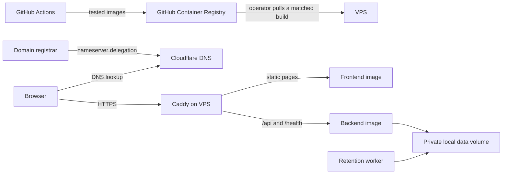

# First-VPS container hosting

Two production images and a single-VPS Compose stack are prepared. Account setup,
public DNS changes, registry permissions and deployment to a real VPS remain
operator actions. No domain, VPS, registrar or Cloudflare account is purchased
or changed by these files. Start with Cloudflare DNS-only; proxying is optional.

## Architecture and scope



Only Caddy exposes host ports: TCP 80, TCP 443 and UDP 443 for HTTP/3. The API
and static server have no published ports. Caddy terminates TLS; the API trusts
forwarded scheme/host information only because its port is reachable solely on
the private Compose network. Do not publish port 8000 or expose that network to
untrusted workloads. Frontend and API share one public HTTPS origin.

The images target Linux amd64/arm64. This means you can move the software to a
compatible VPS; it does **not** move its data or make it a distributed service.
Keep one active VPS with one trusted local data volume. Multi-host/NFS operation
still needs the changes described in [deployment security](DEPLOYMENT_SECURITY.md).

## What is prepared

- `deploy/backend.Dockerfile`: Python 3.14, hashed/pinned runtime dependencies,
  unprivileged UID 10001, no test packages or Playwright/browser login.
- `deploy/frontend.Dockerfile`: a Node 24 build stage and an unprivileged Caddy
  static-server stage. Only `dist` enters the final image, including `/admin/`.
- `.dockerignore`: an allowlist; `.env`, sessions, logs, worktrees and fixtures
  never enter either build context. Runtime secrets are not build arguments.
- `deploy/Caddyfile`: automatic HTTPS, separate `/api` routing, private-response
  cache controls and no request access/error logs that could expose URLs/headers.
- `deploy/compose.yaml`: persistent private data, read-only roots, dropped
  capabilities, health checks and hourly private-data maintenance.
- `.github/workflows/containers.yml`: backend/frontend checks and an actual local
  HTTPS container smoke test before publishing. Feature/PR builds cannot publish.
- `scripts/package_companions.py`: exact-host production Chrome/Firefox packages.

Base-image digests and Actions commit SHAs are pinned. Dependabot proposes
reviewable Docker/Actions/npm updates; it does not auto-merge them. Runtime Python
upgrades require changing `requirements-runtime.in`, regenerating the hashed
lock and rerunning verification. The development requirements are separate.

## Domain, registrar and Cloudflare

You can keep your domain at a registrar of your choice. Adding it to Cloudflare
normally means adding its DNS zone there and changing the **nameservers at the
registrar** to the pair Cloudflare assigns. Registering/transferring the domain
to Cloudflare Registrar is optional. Caddy is a program on the VPS, not a DNS
provider to which you delegate nameservers.

1. Choose the domain and application hostname, for example `betterilias.ch`.
2. Add the domain to Cloudflare and check the imported records. Preserve existing
   MX/TXT mail records, SPF/DKIM/DMARC and unrelated services.
3. Follow Cloudflare's DNSSEC migration instructions before replacing nameservers;
   an old registrar DS record can make the new zone fail validation.
4. Set the assigned nameservers at the registrar and wait until the zone activates.
5. Create `A` records for `@` (`betterilias.ch`) and `www` (`www.betterilias.ch`)
   pointing to the VPS's public IPv4 (`www` permanently redirects to the canonical
   `https://betterilias.ch` origin). Add `AAAA` only if the VPS actually serves
   those hostnames over public IPv6.
6. Select **DNS only** (grey cloud) initially. Application HTTPS traffic goes
   directly to Caddy; Cloudflare provides DNS without proxying the app.

Cloudflare is optional: another authoritative DNS provider can point to the same
VPS. If you later choose its orange-cloud proxy, use **Full (strict)**, keep valid
origin TLS, bypass caching for `/api/*` and `/admin*`, and test large uploads,
downloads, extensions and calendar clients. Review that additional processing of
application traffic before enabling it. WAF challenges must not break non-browser
clients. Do not use Flexible TLS for this app.

References: [Cloudflare nameserver setup](https://developers.cloudflare.com/dns/zone-setups/full-setup/setup/),
[DNS-only versus proxied records](https://developers.cloudflare.com/dns/proxy-status/),
[Full (strict)](https://developers.cloudflare.com/ssl/origin-configuration/ssl-modes/full-strict/),
[Caddy HTTPS requirements](https://caddyserver.com/docs/automatic-https).

## GitHub images and review

The workflow verifies every push/PR. After successful checks it publishes on
`main`, `v*` tags, and scheduled/manual runs of `main`, using the repository's
`GITHUB_TOKEN` with job-scoped package-write permission. No VPS SSH key or
Cloudflare token is needed in Actions. Permit these official actions and package
publishing in your repository/organisation settings if policy restricts them.
Protect `main` and release tags. There is no automatic deployment to the VPS.

Images are named `ghcr.io/<lowercase-owner>/<repo>-backend` and `-frontend`.
For this repository the prefix is `ghcr.io/m4anuel/betterilias`. Each run publishes
the same unique `build-<run-id>-<attempt>` tag for both images and records digests
in its summary. Deploy a matched build, not floating `main` or `sha-*` aliases:
rerunning a commit can produce a new image. Keep the previous build for rollback.
Registry tags are still mutable to an authorised publisher; digests provide the
strongest exact-image identification if you pin the two image references directly.

New GHCR packages default to private. Either deliberately make the source-only
images public, or authenticate on the VPS with a classic PAT limited to
`read:packages`, using `docker login ghcr.io --password-stdin`. Do not place that
token in Compose, shell history or frontend configuration. Docker credentials on
the host are sensitive too. See [GHCR permissions and digest pulls](https://docs.github.com/en/packages/working-with-a-github-packages-registry/working-with-the-container-registry)
and [Actions image publication](https://docs.github.com/en/actions/tutorials/publish-packages/publish-docker-images).

The branch must be reviewed/merged before automatic `main` publication runs.
Local image builds and smoke checks do not prove the repository's GHCR permission
settings are enabled. GitHub package publication is not deployment approval.

## First VPS setup

Use a Linux VPS supported by Docker Engine/Compose, keep the OS patched and use
SSH keys. Install Docker through its [official instructions](https://docs.docker.com/engine/install/).
Treat root/Docker access as access to all student session credentials. Choose
capacity through staging measurements; this configuration is not a user-count
or university traffic-limit guarantee.

Place the deployment files in `/opt/betterilias` (or adjust the paths consistently):

```text
compose.yaml
Caddyfile
deploy.env       copied from deploy/deploy.env.example
backend.env      copied from deploy/backend.env.example
```

Set `IMAGE_PREFIX`, a published `IMAGE_TAG`, the bare `APP_DOMAIN` hostname and
`ACME_EMAIL` in `deploy.env`. In `backend.env`, set a separate random
`ADMIN_API_KEY` if administration is desired. Generate it with
`python -c "import secrets; print(secrets.token_urlsafe(32))"` and store it privately.
New optional error-report collection stays disabled until its operator name and
public HTTPS privacy-notice URL are configured. The app runtime is forced to
production; raw captures remain off.

Protect both files with owner-only permissions (`chmod 600`). Do not use the
development `.env` wholesale or put these files in Git. `docker compose config`
can print expanded secrets: use `config --quiet` to validate.

Allow SSH from trusted sources and public TCP 80/443 (UDP 443 is optional for
HTTP/3). Verify the provider firewall as well as the OS firewall. Docker-published
ports need special attention to host firewall rules; the API/static service have
no published ports. Do not expose Docker's API. No Cloudflare DNS API plugin/key
is required for ordinary Caddy HTTP/TLS certificate validation.

```sh
cd /opt/betterilias
docker compose --env-file deploy.env -f compose.yaml config --quiet
docker compose --env-file deploy.env -f compose.yaml pull
docker compose --env-file deploy.env -f compose.yaml up -d --wait
curl -f https://betterilias.ch/health
```

DNS must already reach this VPS for public certificates. Caddy persists its
certificate state in separate `caddy_data`/`caddy_config` volumes. A real public
certificate and domain reachability still require validation on your chosen VPS.

## Private data, logs and maintenance

One private `app_data` volume is mounted at `/data`; calendar and feedback staging
use that working directory. Sessions, coordination, SQLite diagnostics/reports,
calendar/feed-token state and staging survive container/image replacement. The
frontend/Caddy never mount this private volume. New volumes inherit UID 10001;
restored data must retain compatible ownership and private permissions. Upload
temporary files use private `/data/.tmp`, not the read-only image filesystem.

The API/maintenance Docker stdout logs are disabled to avoid a second unexpired
copy of diagnostics. Use `/admin/` or, from the VPS:

```sh
docker compose --env-file deploy.env -f compose.yaml exec backend python -m backend.diagnostics events --limit 50
docker compose --env-file deploy.env -f compose.yaml exec backend python -m backend.diagnostics reports --state open
```

Caddy retains bounded operational startup/TLS logs but suppresses access and
HTTP-error request records. Keep those exclusions; do not enable debug/raw access
logging while handling student traffic. Container health/exit status and the
private dashboard remain the normal operational entry points. A failed private
database must be investigated, not worked around by enabling raw logging.

The maintenance service purges hourly; failures exit so the restart status is
visible. For retention even while the normal Compose services are stopped, install
the optional `retention.service`/`.timer`, adjusting `/opt/betterilias` if needed:

Copy both files from `deploy/` to `/opt/betterilias` first.

```sh
sudo cp retention.service retention.timer /etc/systemd/system/
sudo systemctl daemon-reload
sudo systemctl enable --now retention.timer
```

This requires Docker to remain running. No timer can physically remove data while
the VPS is powered off; expired records remain excluded on access. Apply the
operator's [privacy and retention policy](OBSERVABILITY_PRIVACY.md), including
backups, snapshots and deletion requests. Exclude diagnostic logs/reports and
temporary/staged uploads from routine backups; do not blindly restore older
revoked credentials. Backup and restore policy still requires operator review.

To move an existing installation, stop writers gracefully, transfer the current
private volume securely with permissions intact, update DNS and start the new
VPS. Do not run independent old/new VPSs against diverging copies. Images alone
do not migrate data. Remove the old host's private data according to the agreed
retention process after confirming migration.

## Production companions and first user validation

The development companions authorise localhost. Generate matching packages for
the real domain before asking friends to sign in:

```sh
python scripts/package_companions.py --app-origin https://betterilias.ch --output scratch/production-companions
```

Both manifests gain only the chosen app host; development host permissions are
removed, defaults are updated and the Firefox Xray bridge is preserved. The
source development extensions stay unchanged. Output contains unpacked folders
and ZIPs; existing output is never overwritten. Existing installations may still
have old saved URLs, which need updating. Browser-store publication/signing is a
separate account process (especially permanent Firefox installation); generating
a ZIP does not make it a signed store release.

Publish the production packages or store listings and update the landing/setup
installation links before inviting users. Those links currently point to the
development extension source on GitHub, whose app permissions cover localhost;
that source package cannot connect to an arbitrary hosted hostname.

Before public rollout check extension login in both browsers, expired/revoked
sessions, native downloads/PDF/video, grading/import safeguards, phone handoff,
calendar-feed HTTPS URLs, report consent/deletion and admin isolation. Confirm
the actual permitted university/media origins and traffic expectations. Review
the public imprint/privacy text against the real operator and hosting provider;
the current UI's hosting-location statements must not be assumed true before a
provider is selected. This container setup is not a DSGVO compliance certificate.

## Updates, rollback and local verification

Choose a reviewed matched `build-*` tag in `deploy.env`, then `pull` and `up -d
--wait`. Keep the previous tag. Roll back both images together; database schema
changes may require a separate migration/restore plan. Never use `down -v` on the
production project: that deletes its persistent data.

Run local production-stack verification with Docker running:

```sh
python scripts/smoke_containers.py --build
```

It creates a unique loopback-only temporary project with synthetic credentials,
uses a temporary local CA, checks static/admin/API routing, Secure cookies,
HTTPS feed URLs, invalid/missing tenant isolation, persistent state across a
restart, retention and proxy-log exclusion, then deletes only its temporary
stack/data. Local test certificate bypass is confined to that script; it is not
used by production Caddy. No live ILIAS credentials are used.

Regenerate Python runtime hashes after a reviewed version change:

```sh
uv pip compile requirements-runtime.in --python-version 3.14 --python-platform x86_64-unknown-linux-gnu --generate-hashes --output-file requirements-runtime.txt
```

The workflow's multi-platform build is separate from public-domain validation.
Record actual local/native/emulated checks when reviewing a release; do not infer
physical-device or live-VPS validation from a local container smoke test.
