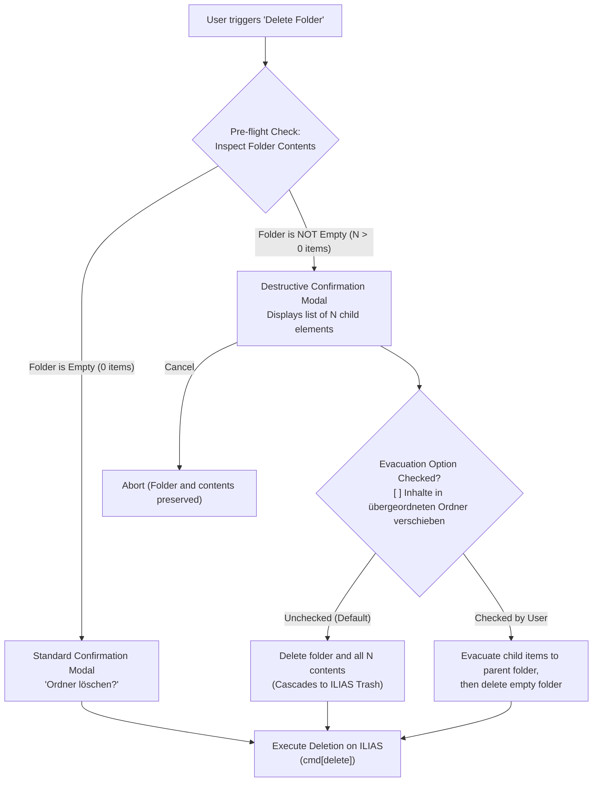

# BetterIlias — Lecture & Folder Management Specification

## Implementation status and native-form corrections

The current implementation extends the foundation below with a single
**Manage this page** mode: creation controls are hidden outside it; files and
folders can be selected, reviewed and deleted through live native confirmation;
shared ordering uses the native Sorting form. Recursive folder reviews are
rechecked before deletion, and changed/uncertain outcomes are never replayed
automatically. Deleting the last item explicitly refreshes the empty cache.

The updated user-goal design, refined implementation brief, protocol mapping,
implemented scope and future page-element/move/copy adapters are in
[`UNIFIED_MANAGEMENT_PLAN.md`](UNIFIED_MANAGEMENT_PLAN.md). That plan supersedes
the earlier proposed controls below. In particular, `select_and_deleting.html`
contains page-element deletion, not repository-object confirmation. Page-element
editing currently has an explicit ILIAS editor handoff in the unified Add
content catalogue; it is not presented as implemented native editing.

The initial authoring implementation provides permission detection, the searchable
30-object Add Object catalogue, folder creation, and course/folder file uploads.
Only Folder and File are currently enabled for creation, subject to the live
container's permissions. Exercise creation, moving/copying and full page-element
editing remain planned; deletion and ordering are implemented as described above.

The saved native folder form offers **Default** (`dtpl_0`) and **Hidden folder**
(`dtpl_5`). The latter is not a column layout. BetterIlias reads the available
templates and selected default from each fresh form rather than assuming a layout.

The saved file form uses a two-step flow: upload the file to the live
`ilObjFileUploadHandlerGUI` URL, then submit the returned `file_id` with the
parallel title/description/resource-ID arrays and selected license to the fresh
form action. Up to three files are processed concurrently, with independent
progress and outcomes. Neither creation POST is retried automatically. A fresh
parent listing must contain a new matching object reference before success is
reported. Confirmation accounts for ILIAS display titles that omit file
extensions, using the action menu's full filename where available. Uncertain
results direct the user to inspect the affected file in ILIAS while other
uploads continue. License options include short German/English explanations.

Implemented routes (numeric parent `ref_id`):

| Method | Endpoint | Purpose |
| :--- | :--- | :--- |
| GET | `/api/materials/{ref_id}/authoring-context` | Current creation types and management/page-edit indicators; native URLs and tokens stay on the server. |
| GET | `/api/materials/{ref_id}/folders/options` | Live native folder templates and default selection. |
| POST | `/api/materials/{ref_id}/folders` | JSON `title`, `description`, optional `template_id`; returns verified material items. |
| GET | `/api/materials/{ref_id}/files/options` | Live license choices and default selection. |
| POST | `/api/materials/{ref_id}/files` | Multipart `file` and `license`; one queued file per request, returning verified material items. |

The shared frontend catalogue is `frontend/src/lib/iliasObjects.ts`; supported
creation types are separate from ILIAS's allowed types. The authoring scraper and
service are isolated in `backend/scrapers/authoring.py` and
`backend/services/authoring.py` for future exercise creation and management.
Regression fixtures under `tests/fixtures/authoring` are sanitized excerpts of
the source page saves. Navigation guards are being implemented separately.

The sections below describe the target design; the status and corrections above
take precedence where they differ from the initial proposal.

## 1. Executive Summary & Core Principles

This specification defines the architecture, workflows, API contracts, and user experience for course authoring and folder management in **BetterIlias**. It allows lecturers and teaching assistants (TAs) to create, edit, organize, move, and delete course contents directly within BetterIlias, without leaving the modern web interface.

### Key Architectural Tenets
1. **True Native Implementation vs. Links**:
   - Simple redirects/external links to ILIAS (e.g. forums, external weblinks, tests) **do not** count as implemented features.
   - Currently natively implemented objects:
     - `file` (File): Previews, downloads, direct rendering.
     - `fold` (Folder): Hierarchical browsing, nested structures, breadcrumb navigation, multi-column layouts.
     - `exc` (Exercise): Submissions, drag-and-drop file upload, TA assignment editor, feedback files, grading.
     - `xoct` (Podcast/Video Series): Dual-stream in-app player with slide sync.
     - `sess` (Session): Structured date/time/room card.
2. **Selective Enablement in "Add Object" Dialog**:
   - The native ILIAS catalog contains **30 distinct object types** across 6 categories.
   - In BetterIlias's new **"Add Object"** dialog, all 30 objects will be displayed under their respective native categories to maintain familiar mental models.
   - **Only the currently supported objects (`Folder`, `File`, `Exercise`) will be active for creation.**
   - The remaining 27 object types will be visually rendered but **deactivated / disabled** with a subtle badge (`Demnächst` / `In Entwicklung`), preventing broken or half-baked flows.
3. **Safety First on Destructive Operations**:
   - Deleting folders containing child elements (files, subfolders, submissions) is high risk. The specification defines an explicit pre-flight inspection and confirmation safeguard before any deletion command is forwarded to ILIAS.
   - **Default Behavior**: Standard cascading deletion (deleting the folder along with its child elements into the ILIAS trash).
   - **Evacuation Option**: Users are explicitly offered a toggle/checkbox to evacuate (move) contained items to the parent folder before deleting the empty container.

---

## 2. Native ILIAS Authoring Analysis

The technical foundation for this specification is derived from real DOM dumps captured from active Uni Bern ILIAS authoring sessions (`htmlfromilias/ActualListOfAllSubjects/Ilias Course Formatting/`):

| Dump File | Native ILIAS Class & Action | Key Technical Findings |
| :--- | :--- | :--- |
| `View_ Content_...html` | `ilrepositorygui&cmd=view` | Author toolbar (`.c-toolbar`) contains **"Add Object"** and **"Edit Page"** buttons when the user has write privileges. Contains the `<dialog>` with drilldown menu of all 30 object types. |
| `New_Folder_...html` | `ilObjFolderGUI&cmd=save&new_type=fold` | Multipart form creating folders: `form/input_0/input_1` (Title), `form/input_0/input_2` (Description), `form/input_3` (Template mode `dtpl_0` standard vs `dtpl_5` custom). |
| `new_file.html` | `ilObjFileGUI&cmd=uploadFiles&new_type=file` | File upload handler: `form/input_0` (files array), `form/input_1` (license radio, e.g. `il_copyright_entry__0__7` for All Rights Reserved). |
| `test_folder_...manage_tab.html` | `ilObjFolderGUI&cmd=post` (Manage Tab) | Batch table containing items with checkboxes `id[] = <ref_id>`. Bottom and top multi-action buttons: `cmd[delete]`, `cmd[cut]`, `cmd[copy]`, `cmd[link]`, `cmd[download]`. |
| `edit_page.html` & `select_and_deleting.html` | `ilpageeditorgui&cmd=post` | Page layout container editor: Resource assignment via `ilPCResourcesGUI`, ordering, and container element deletion. |

---

## 3. Destructive Action Safeguards (Folder & Content Deletion)

> [!CAUTION]
> **The Non-Empty Folder Deletion Workflow:**
> In ILIAS, repository deletion sends objects to the repository trash (`ilRepositoryTrashGUI`). When a folder is deleted, all contained child elements are deleted along with it. BetterIlias defaults to this standard behavior while providing full visibility of affected contents and offering an optional one-click evacuation safeguard.



### Deletion Safety Requirements
1. **Pre-Flight Inspection**:
   - Before confirming deletion of any folder `ref_id`, BetterIlias queries the folder contents (`GET /api/materials/{ref_id}`).
   - If `items.length === 0`: Show standard confirmation dialog with simple "Löschen" button.
   - If `items.length > 0`: Display a **Destructive Action Modal**:
     - Clearly lists the total number of items and breakdown (e.g., `3 Dateien, 1 Übung, 2 Unterordner`).
     - Shows an expandable preview listing the exact titles of contents that will be deleted.
2. **Default Deletion with Evacuation Option**:
   - **Default Action**: Deletes the folder and all its contents (matching standard file-system and ILIAS conventions).
   - **Evacuation Checkbox**: A clearly visible checkbox:
     > `[ ] Enthaltene Materialien in den übergeordneten Ordner verschieben (nicht löschen)`
     - When checked by the user: BetterIlias executes a batch move (`cmd[cut]`) of child items to the current parent folder first, and then deletes the now-empty folder.
3. **Audit & Trash Reference**:
   - Backend logs deleted `ref_id`s, titles, and timestamp so TAs can easily identify and locate items in ILIAS's native trash bin if an accidental deletion ever occurs.

---

## 4. Feature Specification & Workflows

### 4.1 Permission Detection
BetterIlias inspects parsed course and folder HTML for authoritative instructor/TA indicators:
- Detection of toolbar buttons: `Add Object` (`Neues Objekt hinzufügen`), `Edit Page` (`Seite bearbeiten`), or the `Manage` (`Verwalten`) subtab.
- When detected, BetterIlias enables the authoring toolset in the top bar:
  - **`+ Neues Objekt`** primary button.
  - **`Organisieren / Verwalten`** toggle button (switches between Clean Student View and Management/Selection View).

### 4.2 The "Add Object" Modal (`AddObjectModal`)
When clicking `+ Neues Objekt`, a clean modal appears displaying the 6 native ILIAS categories:

```
┌────────────────────────────────────────────────────────────────────────┐
│ Neues Objekt hinzufügen                                      [ × ]     │
│ Suchen: [ Nach Objekt suchen...                                      ] │
├────────────────────────┬───────────────────────────────────────────────┤
│ • Inhalt               │ [📁 Ordner]                                  │
│ • Video & Audio        │   Strukturieren Sie Materialien in Abschnitte │
│ • Organisation         │   Status: Aktiv                              │
│ • Kommunikation        │                                               │
│ • Leistungsüberprüfung │ [📄 Datei(en)]                                │
│ • Feedback & Umfragen  │   Laden Sie Folien, Handouts, PDFs hoch       │
│                        │   Status: Aktiv                              │
│                        │                                               │
│                        │ [📝 Übungseinheit]                            │
│                        │   Erstellen Sie eine neue Übungsserie         │
│                        │   Status: Aktiv                              │
│                        │                                               │
│                        │ [🌐 Weblink] ── [Demnächst]                  │
│                        │ [📖 Glossar] ── [Demnächst]                  │
│                        │ [📚 Lernmodul ILIAS] ── [Demnächst]          │
└────────────────────────┴───────────────────────────────────────────────┘
```

#### Active Creation Wizards:
1. **Create Folder (`CreateFolderModal`)**:
   - Fields:
     - `Titel` (required, text, max 200 chars).
     - `Beschreibung` (optional, textarea).
     - `Ansichtsmodus` (radio: Standard-Listenansicht vs. Spaltenansicht).
   - Backend dispatch: POST to ILIAS `ilObjFolderGUI&cmd=save&new_type=fold`.
2. **Upload Files (`UploadFilesModal`)**:
   - Multi-file drag & drop zone.
   - File queue showing name, file size, upload progress, and remove button.
   - License selector dropdown / radios (defaults to `"All rights reserved"`).
   - Backend dispatch: POST multipart form to `ilObjFileGUI&cmd=uploadFiles&new_type=file&origin=dropzone`.
3. **Create Exercise (`CreateExerciseModal`)**:
   - Fields: Exercise Title, Description.
   - Backend dispatch: Creates exercise container (`ilObjExerciseGUI&new_type=exc`), then routes directly into the already existing BetterIlias `TAExerciseEditorView` to configure assignments.

#### Deactivated Objects:
- All other 27 objects (e.g., `Glossar`, `Wiki`, `Blog`, `Test`, `LiveVoting`, `Lernsequenz`) are displayed in their respective category with disabled visual styling, low contrast icon, and a badge: `In Vorbereitung`. Clicking shows a tooltip: *"Dieses Objekt wird in einer zukünftigen Version von BetterIlias direkt unterstützt."*

### 4.3 Course Content Management View (`ManageItemsView`)
When the user toggles **"Organisieren"** on any course or folder page:
1. **Item Selection**:
   - A selection checkbox appears on every material card/row.
   - Master checkbox in the header: *"Alle auswählen"*.
2. **Batch Action Bar** (floats smoothly at the bottom or top of viewport):
   - **`Verschieben` (Move)**: Opens `FolderPickerModal` allowing the user to select any folder within the course hierarchy, triggering native ILIAS `cmd[cut]` and paste.
   - **`Kopieren` (Copy)**: Clones selected materials into another target folder (`cmd[copy]`).
   - **`Herunterladen` (Download)**: Requests multi-file ZIP download (`cmd[download]`).
   - **`Löschen` (Delete)**: Triggers the deletion workflow described in Section 3 (`cmd[delete]`).
3. **Inline Single-Item Actions**:
   - A 3-dot menu on each item provides quick individual actions:
     - `Umbenennen` (Rename title / edit description).
     - `In anderen Ordner verschieben` (Move).
     - `Löschen` (Delete with safety confirmation).

---

## 5. Backend REST API Specification

### 5.1 Endpoints Overview

| Method | Endpoint | Description |
| :--- | :--- | :--- |
| `GET` | `/api/materials/{ref_id}/authoring-context` | Returns edit permissions and child item counts for safety checks. |
| `POST` | `/api/materials/{ref_id}/folders` | Creates a new folder inside container `ref_id`. |
| `POST` | `/api/materials/{ref_id}/files` | Uploads one or more files with selected copyright license. |
| `POST` | `/api/materials/{ref_id}/exercises` | Creates a new exercise container. |
| `POST` | `/api/materials/{ref_id}/batch/delete` | Deletes selected items (cascading by default, or evacuating if requested). |
| `POST` | `/api/materials/{ref_id}/batch/move` | Moves selected items to `target_ref_id`. |
| `PATCH` | `/api/materials/{ref_id}/item/{item_ref_id}` | Updates an item's title and description. |

### 5.2 Request & Response Schemas

#### Authoring Context
```typescript
interface AuthoringContextResponse {
  ref_id: string;
  can_create: boolean;
  can_manage: boolean;
  can_edit_page: boolean;
  rtoken?: string;
}
```

#### Folder Creation
```typescript
interface CreateFolderRequest {
  title: string;
  description?: string;
  view_mode?: "standard" | "columns";
}

interface CreateFolderResponse {
  success: boolean;
  new_ref_id: string;
  title: string;
}
```

#### Batch Deletion
```typescript
interface BatchDeleteRequest {
  item_ids: string[];
  evacuate_to_parent?: boolean; // Default: false (deletes folder and contents together)
}

interface BatchDeleteResponse {
  success: boolean;
  deleted_count: number;
  evacuated_count: number;
  affected_items: Array<{
    ref_id: string;
    title: string;
    type: string;
  }>;
}
```

---

## 6. Implementation Roadmap & Phases

```mermaid
flowchart LR
    subgraph Phase 1: Core Creation
        P1A["Permission Detection in Course/Folder Scraper"] --> P1B["AddObjectModal (Active vs Disabled)"]
        P1B --> P1C["CreateFolderModal & UploadFilesModal"]
    end

    subgraph Phase 2: Safe Deletion & Organization
        P2A["Child Count Pre-Flight Check"] --> P2B["Destructive Confirmation Modal with Evacuation Option"]
        P2B --> P2C["Batch Actions Bar (Delete, Move)"]
    end

    subgraph Phase 3: Exercises & Refinement
        P3A["Exercise Container Creation"] --> P3B["Connect with TAExerciseEditorView"]
        P3B --> P3C["Full i18n & a11y Audits"]
    end

    Phase 1 --> Phase 2 --> Phase 3
```

1. **Phase 1: Authoring Context & Essential Creation**:
   - Implement `authoring-context` detection in `materials.py`.
   - Build `AddObjectModal` rendering all 30 ILIAS object types, activating `Folder`, `File`, and `Exercise`.
   - Implement folder creation and multi-file upload dropzone endpoints.
2. **Phase 2: Deletion Safeguards & Batch Organization**:
   - Implement pre-flight folder contents inspection.
   - Build `DeleteSafetyModal` defaulting to cascading deletion with an optional evacuation checkbox.
   - Implement batch delete (`cmd[delete]`) and batch move (`cmd[cut]`) endpoints.
3. **Phase 3: Exercise Creation & Course Layout Integration**:
   - Add new exercise container creation routed into `TAExerciseEditorView`.
   - Complete bilingual localisation (`locales/de.json` & `locales/en.json`) and run build verification.
